# Challenger 650 Fuselage Panel Stress Analysis

Analytical and Abaqus finite element analysis of a pressurised fuselage section. The aim is to analyse a curved fuselage skin under cabin pressure, add a cut-out, study how the stresses and deflections change, and then look at reinforcing the opening.

**Status: work in progress.** The baseline model (no cut-out) and the quarter-panel symmetry model are verified against thin-walled pressure vessel theory. The window cut-out model is complete, with a mesh convergence study at the window corner. The reinforcement study is next.

## The aircraft

The geometry is representative of a Bombardier Challenger 650 fuselage. It is not a model of the real structure.

| Parameter | Value | Note |
|---|---|---|
| Fuselage diameter | 2.69 m | [FlightGlobal](https://www.flightglobal.com/business-jets/1997/11/challenge-well-met/) |
| Skin thickness | 1 mm | Estimate; no published figure |
| Internal pressure | 60.7 kPa | Approximate maximum cabin pressure differential |
| Material | 2024-T3 aluminium | Exact alloy not published; this is a common fuselage skin alloy ([data sheet](https://www.aerospacemetals.com/wp-content/uploads/2023/06/Aluminum-2024-T3.pdf)) |
| Young's modulus | 73.1 GPa | |
| Poisson's ratio | 0.33 | |
| Yield strength | 345 MPa | |
| Ultimate tensile strength | 483 MPa | |
| Density | 2.78 g/cm³ | |

## Theory

The fuselage is treated as a closed, thin-walled pressure vessel.

Assumptions:

- Variation in thickness is negligible
- Radial stress is much smaller than hoop stress, so it is ignored
- The wall is thin: D/t is about 2,690, against a usual limit of D/t > 20

[`stress_calculator.py`](stress_calculator.py) calculates the hoop, longitudinal and von Mises stresses:

```
python3 stress_calculator.py
```

## Baseline model (no cut-out)

A 1 m length of the full fuselage circumference, modelled in Abaqus/Standard as a shell. A membrane would do for this case, but a shell is used so the same model carries over to the cut-out, where the skin bends locally.

| Item | Setting |
|---|---|
| Geometry | Cylinder, radius 1.345 m, length 1 m |
| Elements | 850 S4R shells (85 around the circumference, 10 along the length), 935 nodes |
| Section | Homogeneous shell, 1 mm |
| Analysis | Linear static |
| Units | m, N, Pa |

Loads and boundary conditions:

| Item | Where | Represents |
|---|---|---|
| Pressure, 60,700 Pa | Inner face | Cabin pressure |
| Shell edge load, 40,821 N/m | One end | The axial tension from the closed ends of the fuselage |
| Circumferential and axial displacement fixed, in a cylindrical coordinate system | The other end | The rest of the fuselage holding the section in place |


### Results

| Quantity | Theory | Abaqus | Difference |
|---|---|---|---|
| Hoop stress | 81.64 MPa | 81.57 to 81.60 MPa | under 0.1% |
| Longitudinal stress | 40.82 MPa | 40.82 to 40.83 MPa | under 0.1% |
| Von Mises stress | 70.70 MPa | 70.64 to 70.67 MPa | under 0.1% |
| Radial growth | 1.254 mm | 1.253 mm (mean) | 0.1% |
| Axial stretch | 0.1899 mm | 0.1902 mm | 0.2% |

The model reproduces the theory to within 0.2% on stresses and displacements.

| Von Mises | Longitudinal | Hoop |
|---|---|---|
| 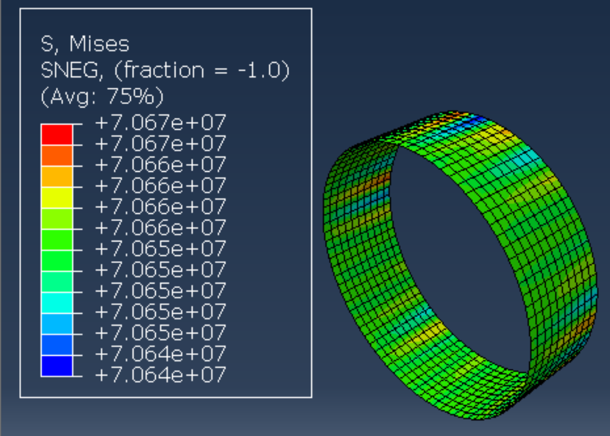 | 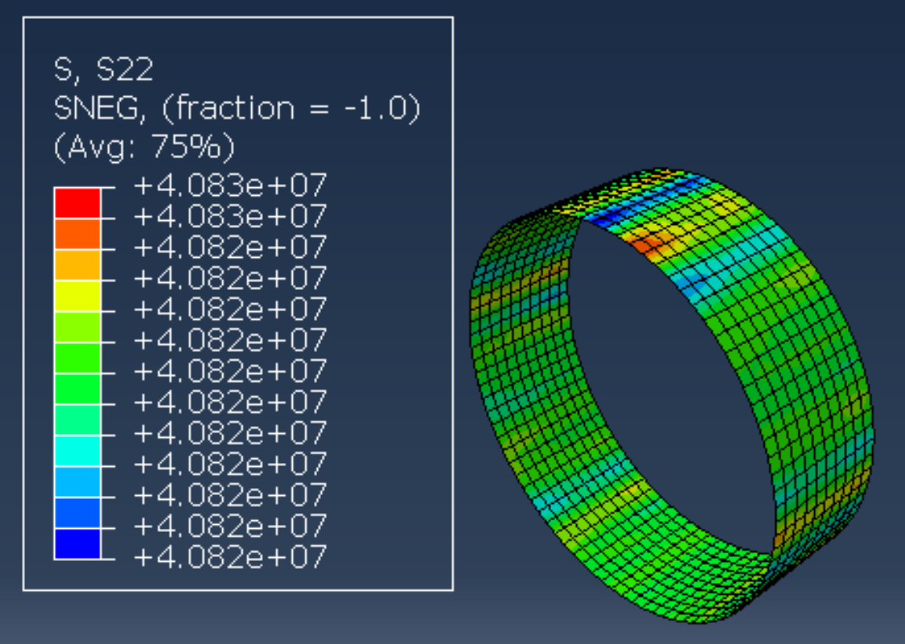 | 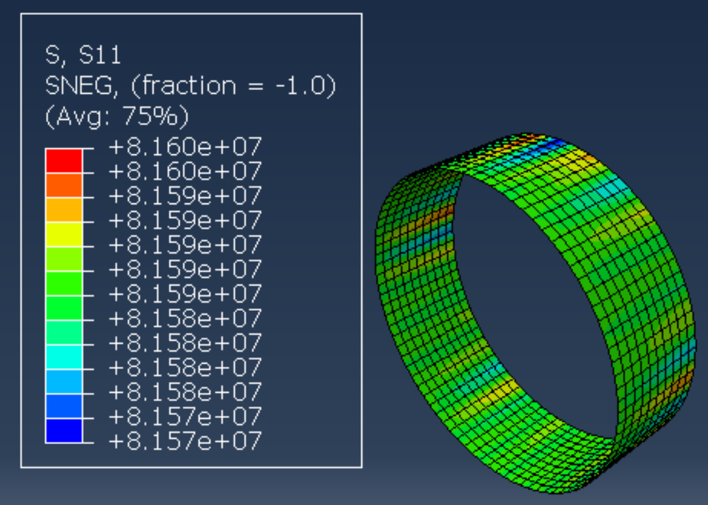 |

Stresses are in Pa. The colour bands span less than 0.05% of the value.

Model files are in [`no_cutout/`](no_cutout/).

## Quarter panel symmetry check (no cut-out)

The cut-out model uses symmetry to put the 1,000-node limit where it is needed, at the window. Before adding the window, the quarter panel was run without it to check that the symmetry conditions reproduce the baseline.

Loads and boundary conditions:

| Item | Where | Represents |
|---|---|---|
| Pressure, 60,700 Pa | Inner face | Cabin pressure |
| Shell edge load, 40,821 N/m | Curved edge at Z = 0.5 m | The axial tension from the closed ends of the fuselage |
| ZSYMM | Curved edge at Z = 0 | Mirror plane across the fuselage, through the window centre |
| YSYMM | Straight edge at θ = 0° | Mirror plane along the fuselage, through the window centre |
| XSYMM | Straight edge at θ = 90° | Mirror plane through the top and bottom of the fuselage, so there is a window on each side |

### Results

| Quantity | Theory | Abaqus | Difference |
|---|---|---|---|
| Hoop stress | 81.64 MPa | 81.61 to 81.65 MPa | under 0.05% |
| Longitudinal stress | 40.82 MPa | 40.81 to 40.83 MPa | under 0.05% |
| Von Mises stress | 70.70 MPa | 70.67 to 70.71 MPa | under 0.05% |
| Radial growth | 1.254 mm | 1.254 mm (mean) | under 0.05% |
| Axial stretch (0.5 m length) | 0.0949 mm | 0.0950 mm | under 0.05% |

| Von Mises | Longitudinal | Hoop |
|---|---|---|
| 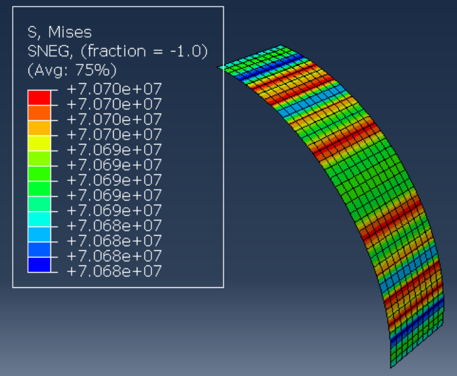 |  | 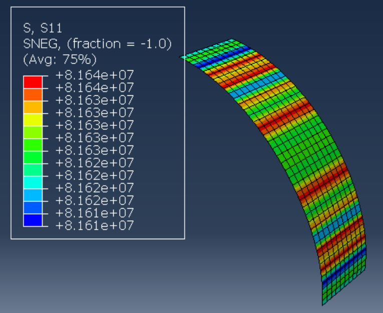 |

## Cut-out model

The cut-out represents a cabin window, as a rectangle with rounded corners.

| Dimension | Value | Note |
|---|---|---|
| Width, along the fuselage | 255 mm | Challenger 605 window ([Simple Flying](https://simpleflying.com/bombardier-challenger-604-vs-605-comparison/)) |
| Height, around the fuselage | 410 mm | Same source |
| Corner radius | 80 mm | Estimate |

| Dimension | Value |
|---|---|
| Radius | 1.345 m |
| Arc | 90° |
| Length | 0.5 m |
| Quarter window, along the fuselage | 127.5 mm |
| Quarter window, around the fuselage | 205 mm |
| Quarter window corner radius | 80 mm |

Loads and boundary conditions are the same as the quarter panel symmetry check, plus a transverse, outward shell edge load of 5,040 N/m on the window edge. This represents the cabin pressure on the window pane: 60,700 Pa × 0.02476 m² (quarter window area) = 1,503 N, spread over 0.298 m of edge.

### Geometric non-linearity

The analysis is run with geometric non-linearity on. A linear analysis balances forces on the undeformed shape, so it cannot see the hoop tension resisting any change of shape. Due to this the small imbalance left by a hand-calculated window load resulted in excessive deformation.

### Initial coarse mesh

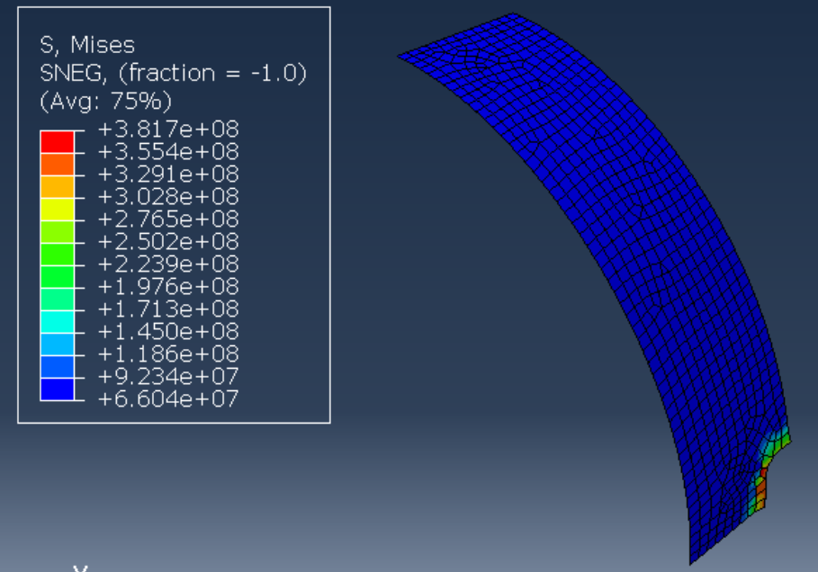

- **Far field:** away from the window, the hoop and longitudinal stresses are within about 0.5% of the no-cut-out values (81.64 and 40.82 MPa)
- **Peak:** at the rounded window corner, about 380 MPa. This mesh is far too coarse to resolve the peak, so it is only an indication

#### Size of the disturbed region

A path plot of von Mises stress running away from the window was used to find how far the window affects the stress, and therefore where the mesh needs to be fine.

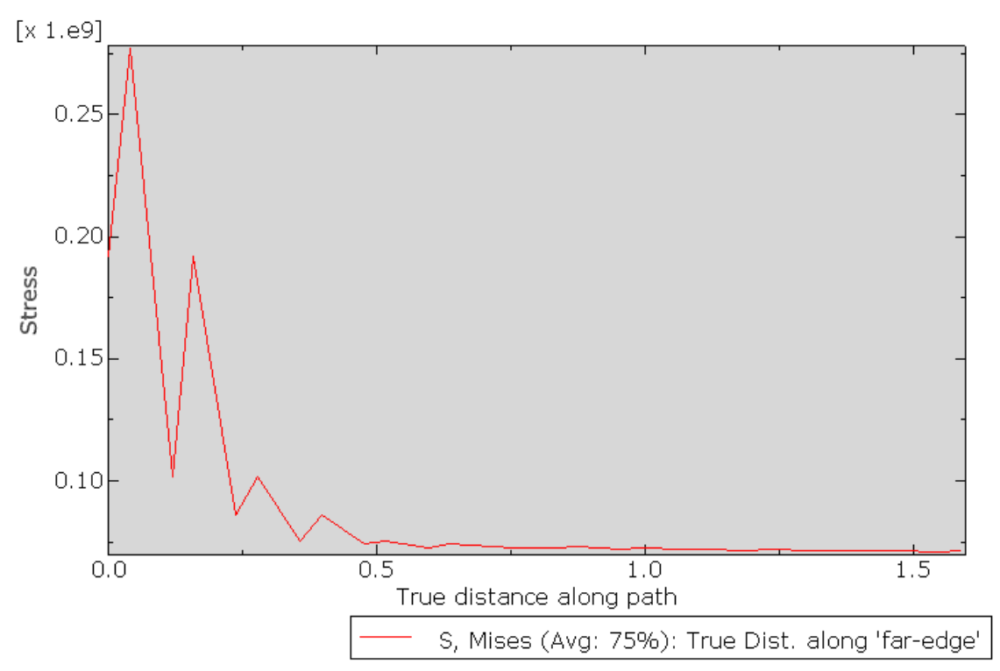

- The stress is highest close to the window and changes most steeply within about 0.1 m of it. Along the fuselage, the stress at the window edge falls from about 271 to 90 MPa within about 75 mm
- It is within about 20% of the far field by about 0.25 m, and within about 5% by about 0.5 m
- Beyond about 0.5 m it is flat at about 72 MPa

From this, the panel was partitioned into three regions, each offset from the window outline.

| Region | Distance from the window edge
|---|---
| Fine band | 0 to 0.1 m
| Transition | 0.1 to 0.3 m
| Rest of the panel | Beyond 0.3 m

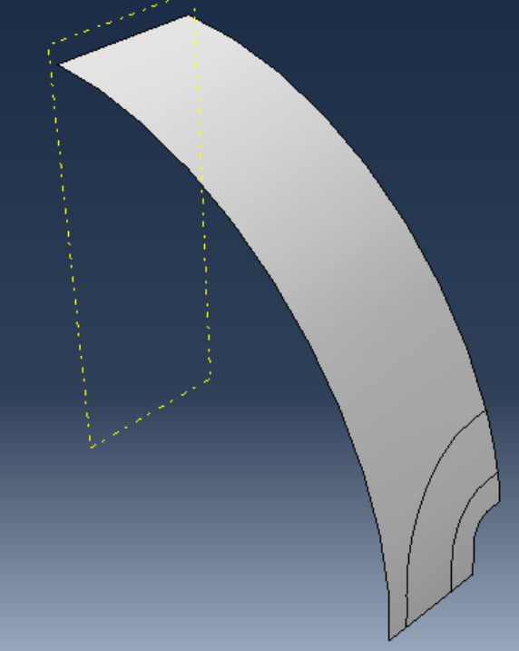

### Mesh convergence

| Level | Nodes | Peak stress | Change |
|---|---|---|---|
| 1 | 450 | 335.9 MPa | |
| 2 | 556 | 399.3 MPa | +19% |
| 3 | 684 | 516.2 MPa | +29% |
| 4 | 797 | 552.7 MPa | +7% |
| 5 | 864 | 613.9 MPa | +11% |
| 6 | 753 | 620.4 MPa | +1.1% |
| 7 | 950 | 630.5 MPa | +1.6% |

Beyond level 5, refinement continued by increasing the element count on the corner arc combined with biasing of edges and increase in mesh size in the far field region. A methodical experiment was difficult due to the node limit. The earlier levels were less systematic, changing different parts of the mesh at each step. A consistent refinement ratio from the start, or submodelling of the corner, would have given a cleaner study.

### Results (final mesh)

**Far field.** Away from the window, the stresses match the model without a cut-out, as they did on the coarse mesh. Close to the window the stress is beyond yield so the opening needs reinforcement.

| Von Mises | Longitudinal | Hoop |
|---|---|---|
| 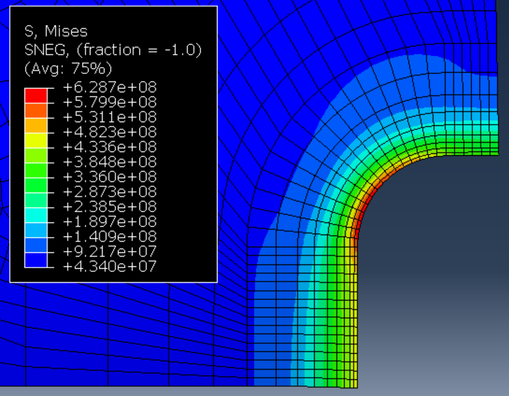 | 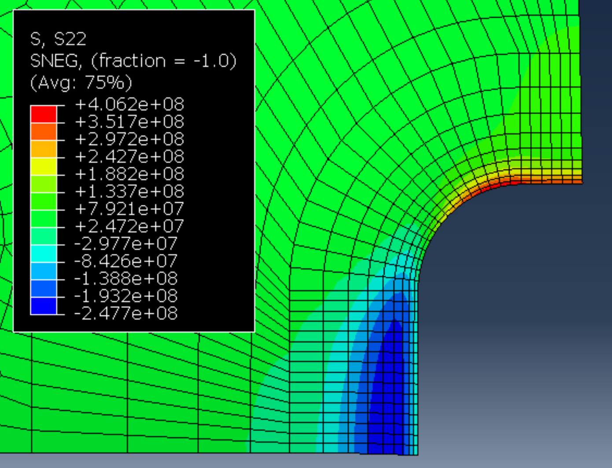 | 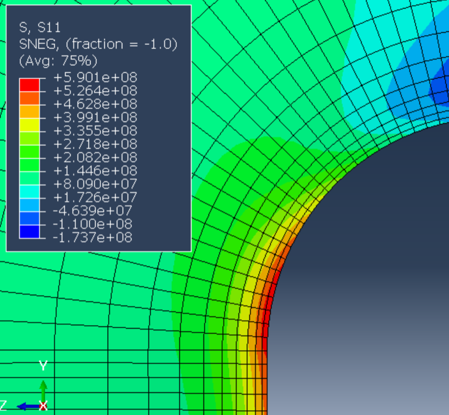 |

## Next steps

1. Reinforce the opening (in progress)
2. Explore further theoretical verification

## Limitations

- Skin thickness and alloy are estimates, not Challenger 650 data
- Bare skin only: no frames, stringers or fasteners, and no window frame around the opening
- The window pane load is applied as a uniform edge load directly on the skin. A real window frame would spread it, so the bending at the window edge is likely overstated
- Window corner radius (80 mm) is an estimate, not Challenger 650 data
- Constant skin thickness
- Mesh convergence study was not as methodical as it could have been
- Pressure loading only; no flight or ground loads