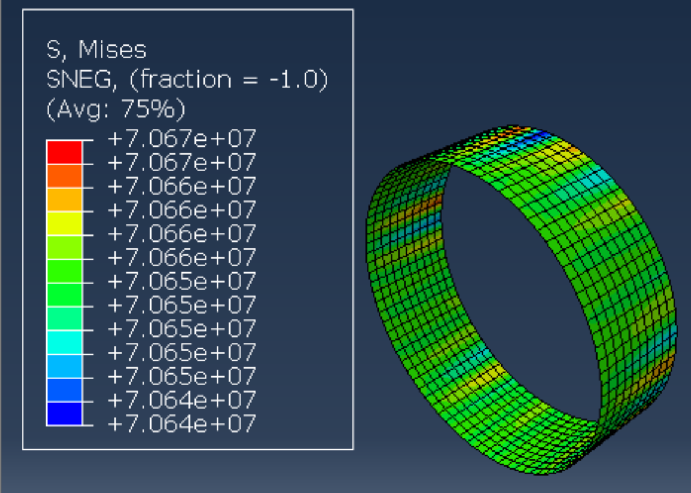
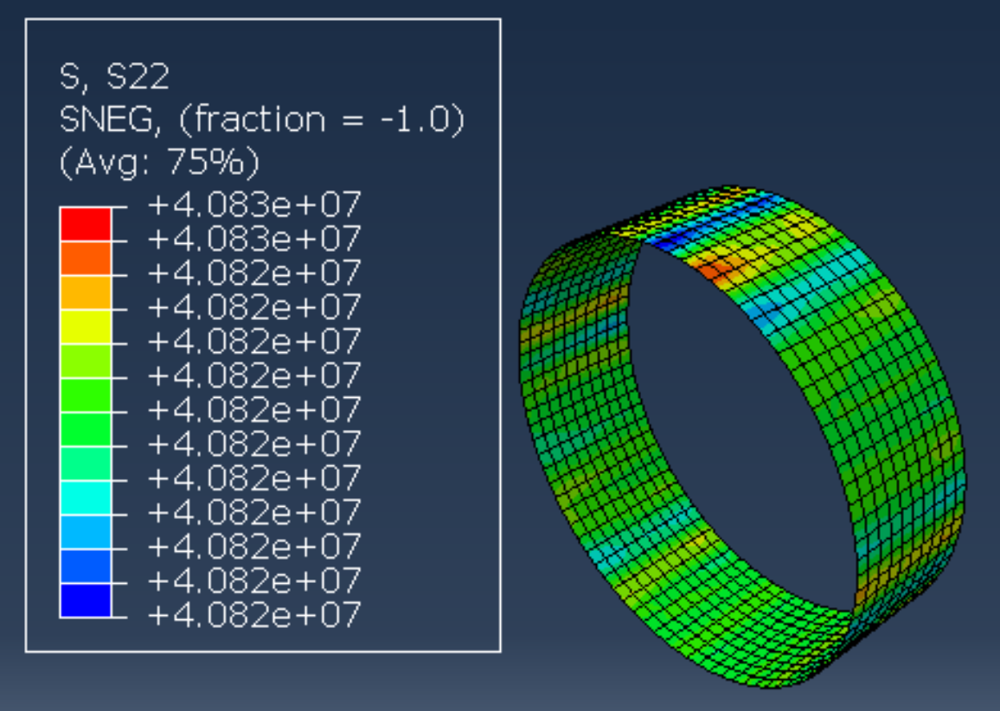
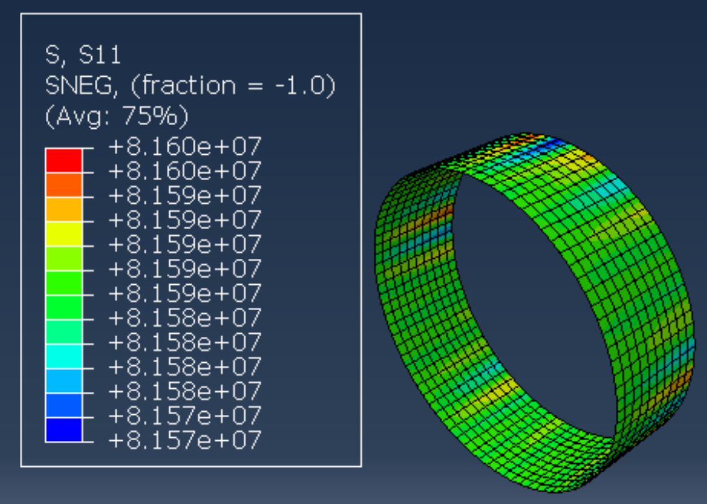

# Pressurised Fuselage Panel Stress Analysis

Analytical and Abaqus finite element analysis of a pressurised fuselage section. The aim is to analyse a curved fuselage skin under cabin pressure, add a cut-out, study how the stresses and deflections change, and then look at reinforcing the opening.

**Status: work in progress.** The baseline model (no cut-out) is built and verified against thin-walled pressure vessel theory. The cut-out and reinforcement studies are next.

## The aircraft

The geometry is representative of a Bombardier Challenger 650 fuselage. It is not a model of the real structure.

| Parameter | Value | Note |
|---|---|---|
| Fuselage diameter | 2.69 m | [FlightGlobal](https://www.flightglobal.com/business-jets/1997/11/challenge-well-met/) |
| Skin thickness | 1 mm | Estimate; no published figure |
| Internal pressure | 60.7 kPa | Approximate maximum cabin pressure differential |
| Material | 2024-T3 aluminium | Exact alloy not published; this is a common fuselage skin alloy ([data sheet](https://www.aerospacemetals.com/wp-content/uploads/2023/06/Aluminum-2024-T3.pdf)) |
| Young's modulus | 73.1 GPa | |
| Poisson's ratio | 0.33 | |
| Yield strength | 345 MPa | |
| Ultimate tensile strength | 483 MPa | |
| Density | 2.78 g/cm³ | |

## Theory

The fuselage is treated as a closed, thin-walled pressure vessel.

Assumptions:

- Variation in thickness is negligible
- Radial stress is much smaller than hoop stress, so it is ignored
- The wall is thin: D/t is about 2,690, against a usual limit of D/t > 20

[`stress_calculator.py`](stress_calculator.py) calculates the hoop, longitudinal and von Mises stresses:

```
python3 stress_calculator.py
```

## Baseline model (no cut-out)

A 1 m length of the full fuselage circumference, modelled in Abaqus/Standard as a shell. A membrane would do for this case, but a shell is used so the same model carries over to the cut-out, where the skin bends locally.

| Item | Setting |
|---|---|
| Geometry | Cylinder, radius 1.345 m, length 1 m |
| Elements | 850 S4R shells (85 around the circumference, 10 along the length), 935 nodes |
| Section | Homogeneous shell, 1 mm |
| Analysis | Linear static |
| Units | m, N, Pa |

Loads and boundary conditions:

| Item | Where | Represents |
|---|---|---|
| Pressure, 60,700 Pa | Inner face | Cabin pressure |
| Shell edge load, 40,821 N/m | One end | The axial tension from the closed ends of the fuselage |
| Circumferential and axial displacement fixed, in a cylindrical coordinate system | The other end | The rest of the fuselage holding the section in place |


### Results

| Quantity | Theory | Abaqus | Difference |
|---|---|---|---|
| Hoop stress | 81.64 MPa | 81.57 to 81.60 MPa | under 0.1% |
| Longitudinal stress | 40.82 MPa | 40.82 to 40.83 MPa | under 0.1% |
| Von Mises stress | 70.70 MPa | 70.64 to 70.67 MPa | under 0.1% |
| Radial growth | 1.254 mm | 1.253 mm (mean) | 0.1% |
| Axial stretch | 0.1899 mm | 0.1902 mm | 0.2% |

The model reproduces the theory to within 0.2% on stresses and displacements.

| Von Mises | Longitudinal | Hoop |
|---|---|---|
|  |  |  |

Stresses are in Pa. The colour bands span less than 0.05% of the value.

Model files are in [`no_cutout/`](no_cutout/).

## Next steps

1. Add a cut-out and compare stresses and deflections with the baseline
2. Local mesh refinement around the cut-out
3. Add reinforcement around the cut-out and compare
4. Perform mesh refinement on secondary models

## Limitations

- Skin thickness and alloy are estimates, not Challenger 650 data
- Bare skin only: no frames, stringers or fasteners
- Constant skin thickness
- Linear elastic material and small displacements
- Pressure loading only; no flight or ground loads
- No fatigue analysis
